# 🖥️ Práctica de Monitorización en Linux

## 📑 Índice

1. [Monitorización de procesos y CPU](#1-monitorización-de-procesos-y-cpu)
2. [Monitorización de memoria RAM](#2-monitorización-de-memoria-ram)
3. [Monitorización del almacenamiento](#3-monitorización-del-almacenamiento)
4. [Monitorización del tráfico de red](#4-monitorización-del-tráfico-de-red)
5. [Monitorización de puertos y conexiones](#5-monitorización-de-puertos-y-conexiones)
6. [Análisis de resultados](#6-análisis-de-resultados)
7. [Conclusión](#7-conclusión)

---

# 1. Monitorización de procesos y CPU

## 1.1. ps

### Finalidad

El comando `ps` permite mostrar información sobre los procesos que se están ejecutando en el sistema, incluyendo su identificador, usuario y consumo de CPU y memoria.

### Sintaxis

```bash
ps [opciones]
```

### Opciones importantes

| Opción | Descripción |
|---|---|
| `aux` | Muestra todos los procesos de todos los usuarios. |
| `-u` | Muestra los procesos de un usuario determinado. |
| `-p` | Muestra información de un proceso concreto mediante su PID. |

### Ejecución

```bash
ps aux
```


### Interpretación

Se muestra una lista de procesos activos. Las columnas permiten conocer el usuario propietario, PID, porcentaje de CPU, memoria utilizada y comando ejecutado.

Es útil para localizar procesos que consumen demasiados recursos.

---

## 1.2. top

### Finalidad

Permite monitorizar en tiempo real los procesos del sistema y el consumo de CPU y memoria.

### Sintaxis

```bash
top [opciones]
```

### Opciones importantes

| Opción | Descripción |
|---|---|
| `-d` | Establece el intervalo de actualización. |
| `-u` | Muestra los procesos de un usuario concreto. |
| `-p` | Monitoriza un proceso específico. |

### Ejecución

```bash
top
```

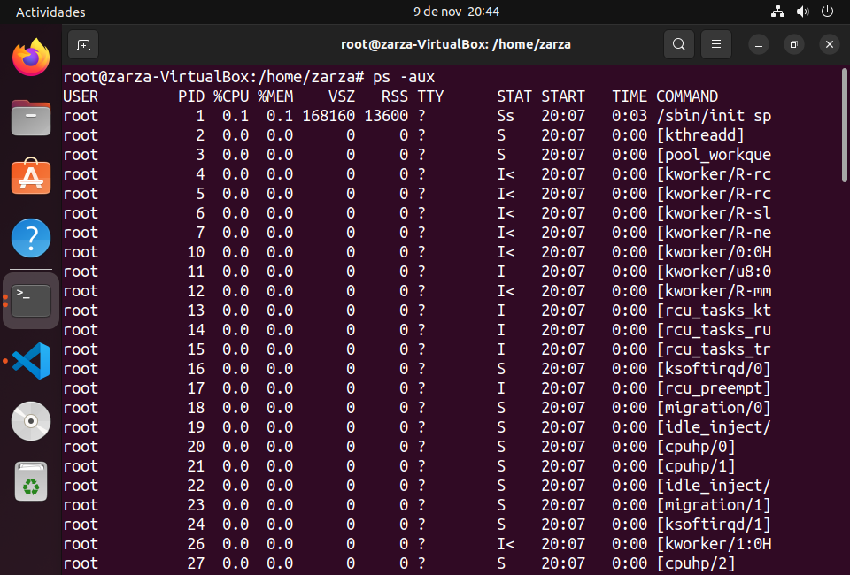

### Interpretación

Muestra información sobre la carga del sistema, uso de CPU, memoria RAM, memoria swap y procesos activos.

Es especialmente útil para detectar procesos que consumen demasiada CPU.

---

## 1.3. htop

### Finalidad

Es una herramienta interactiva que permite visualizar y administrar procesos de una forma más gráfica y sencilla que `top`.

### Sintaxis

```bash
htop [opciones]
```

### Opciones importantes

| Opción | Descripción |
|---|---|
| `-u` | Filtra los procesos por usuario. |
| `-p` | Muestra procesos específicos. |
| `-d` | Modifica el intervalo de actualización. |

### Ejecución

```bash
htop
```


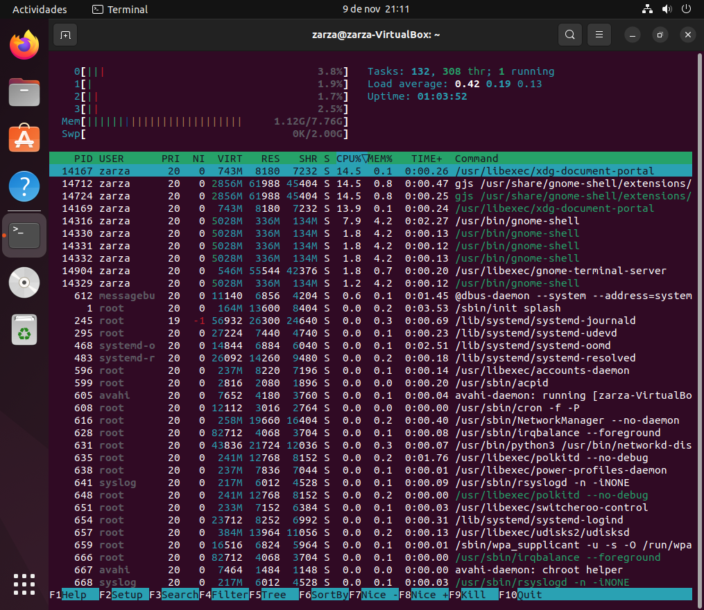

### Interpretación

Presenta barras de colores que representan el uso de CPU, memoria y swap.

También permite ordenar procesos, finalizarlos y consultar información detallada.

---

## 1.4. atop

### Finalidad

Permite monitorizar el rendimiento general del sistema, incluyendo procesos, CPU, memoria, discos y red.

### Sintaxis

```bash
atop [opciones] [intervalo]
```

### Opciones importantes

| Opción | Descripción |
|---|---|
| `-d` | Muestra información de disco. |
| `-n` | Muestra información de red. |
| `-m` | Muestra información de memoria. |

### Ejecución

```bash
sudo atop
```

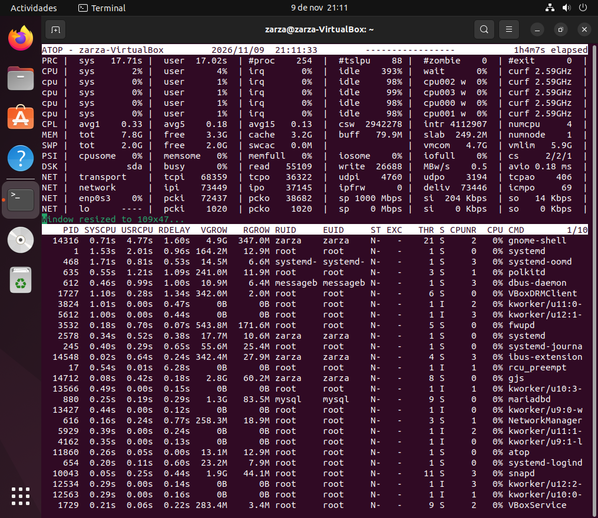

### Interpretación

Muestra información detallada sobre los recursos utilizados por cada proceso.

Permite detectar problemas de rendimiento y analizar qué procesos consumen más recursos.

---

# 2. Monitorización de memoria RAM

## 2.1. free

### Finalidad

El comando `free` permite consultar la cantidad de memoria RAM y memoria swap utilizada y disponible en el sistema.

### Sintaxis

```bash
free [opciones]
```

### Opciones importantes

| Opción | Descripción |
|---|---|
| `-h` | Muestra los valores en unidades fáciles de interpretar. |
| `-m` | Muestra los valores en megabytes. |
| `-g` | Muestra los valores en gigabytes. |
| `-s` | Actualiza la información cada cierto número de segundos. |

### Ejecución

```bash
free -h
```

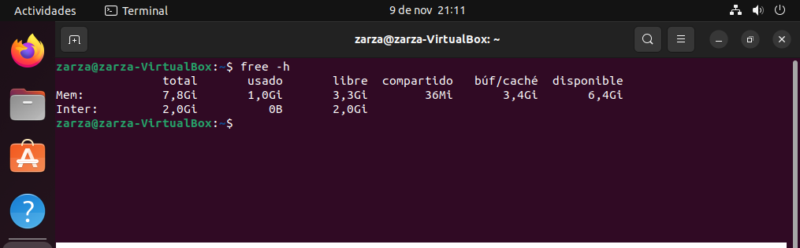

### Interpretación

Muestra la memoria total, utilizada, libre, compartida, disponible y la memoria swap.

Es útil para comprobar si el servidor dispone de suficiente memoria RAM.

---

# 3. Monitorización del almacenamiento

## 3.1. df

### Finalidad

El comando `df` permite consultar el espacio disponible y utilizado en los sistemas de archivos montados.

### Sintaxis

```bash
df [opciones]
```

### Opciones importantes

| Opción | Descripción |
|---|---|
| `-h` | Muestra los tamaños en unidades legibles. |
| `-T` | Muestra el tipo de sistema de archivos. |
| `-i` | Muestra el uso de inodos. |

### Ejecución

```bash
df -h
```

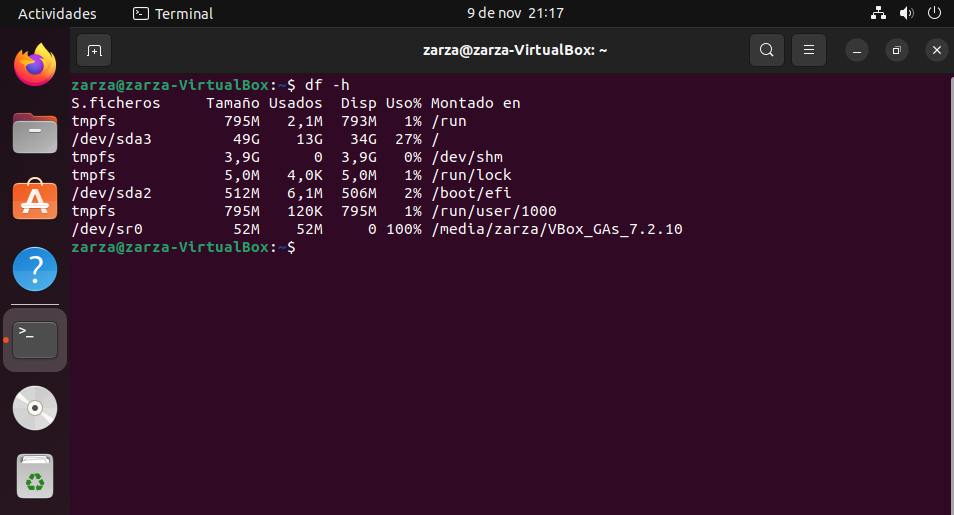

### Interpretación

Muestra el tamaño total de cada sistema de archivos, el espacio utilizado, el espacio disponible y el porcentaje de utilización.

Permite detectar discos o particiones que están cerca de llenarse.

---

## 3.2. du

### Finalidad

El comando `du` permite conocer cuánto espacio ocupa un directorio o archivo en el almacenamiento.

### Sintaxis

```bash
du [opciones] [directorio]
```

### Opciones importantes

| Opción | Descripción |
|---|---|
| `-h` | Presenta los tamaños en unidades legibles. |
| `-s` | Muestra únicamente el tamaño total. |
| `-a` | Incluye también los archivos individuales. |

### Ejecución

```bash
du -sh /var/log
```

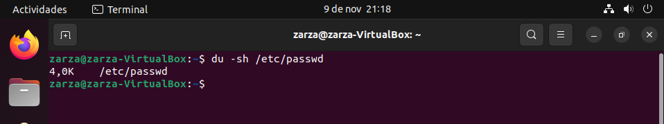

### Interpretación

Muestra el espacio ocupado por el directorio indicado.

Es útil para localizar carpetas que están utilizando demasiado almacenamiento.

---

## 3.3. iostat

### Finalidad

La herramienta `iostat` permite analizar el rendimiento de los dispositivos de almacenamiento y la actividad de entrada y salida (E/S).

### Sintaxis

```bash
iostat [opciones] [intervalo] [repeticiones]
```

### Opciones importantes

| Opción | Descripción |
|---|---|
| `-x` | Muestra estadísticas ampliadas de los dispositivos. |
| `-c` | Muestra estadísticas de CPU. |
| `-d` | Muestra estadísticas de los dispositivos de almacenamiento. |

### Ejecución

```bash
iostat -xz 1 3
```

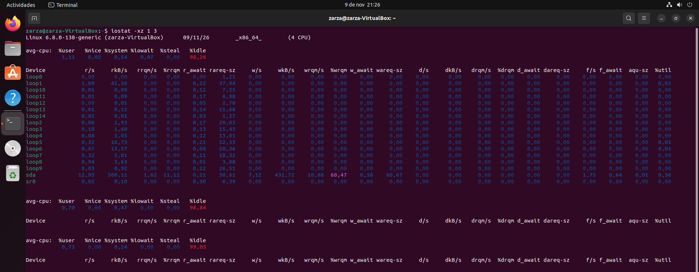

### Interpretación

Muestra estadísticas de lectura y escritura, transferencias por segundo, utilización del dispositivo y tiempos de espera.

Permite detectar posibles cuellos de botella en el disco.

---

# 4. Monitorización del tráfico de red

Para identificar la interfaz de red se utiliza el siguiente comando:

```bash
ip -br link
```

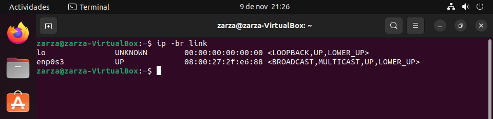

En esta máquina virtual se utiliza `enp0s3` como nombre de interfaz de red.

## 4.1. tcpdump

### Finalidad

Permite capturar y analizar paquetes que circulan por una interfaz de red.

### Sintaxis

```bash
tcpdump [opciones]
```

### Opciones importantes

| Opción | Descripción |
|---|---|
| `-i` | Selecciona la interfaz de red. |
| `-c` | Establece el número máximo de paquetes. |
| `-n` | Evita resolver nombres de direcciones IP y puertos. |

### Ejecución

```bash
sudo tcpdump -i enp0s3 -c 10
```

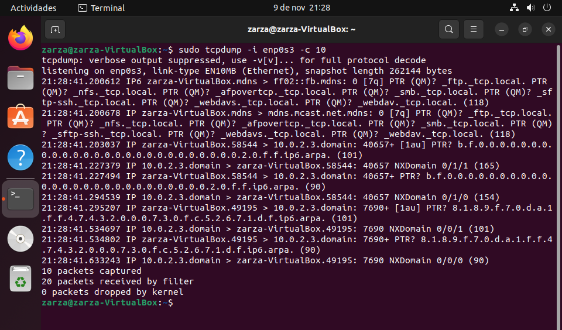

### Interpretación

Muestra información de los paquetes capturados, incluyendo direcciones IP de origen y destino, protocolos y puertos.

Es útil para analizar problemas de comunicación y diagnosticar tráfico de red.

---

## 4.2. tcptrack

### Finalidad

Permite visualizar las conexiones TCP activas y consultar información sobre el tráfico de cada conexión.

### Sintaxis

```bash
tcptrack [opciones]
```

### Opciones importantes

| Opción | Descripción |
|---|---|
| `-i` | Selecciona la interfaz de red. |
| `-r` | Establece la velocidad de actualización. |

### Ejecución

```bash
sudo tcptrack -i enp0s3
```

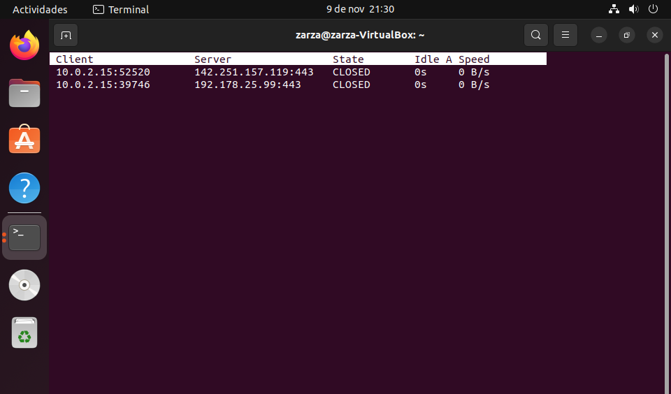

### Interpretación

Muestra las conexiones TCP, sus direcciones de origen y destino, el estado de las conexiones y los datos relacionados con el tráfico.

Es útil para observar las conexiones que mantiene el servidor.

---

## 4.3. iptraf-ng

### Finalidad

Es una herramienta interactiva que permite monitorizar el tráfico de red y consultar estadísticas de las interfaces y conexiones.

### Sintaxis

```bash
iptraf-ng [opciones]
```

### Opciones importantes

| Opción | Descripción |
|---|---|
| `-i` | Selecciona una interfaz de red. |
| `-g` | Muestra estadísticas generales del tráfico. |

### Ejecución

```bash
sudo iptraf-ng
```


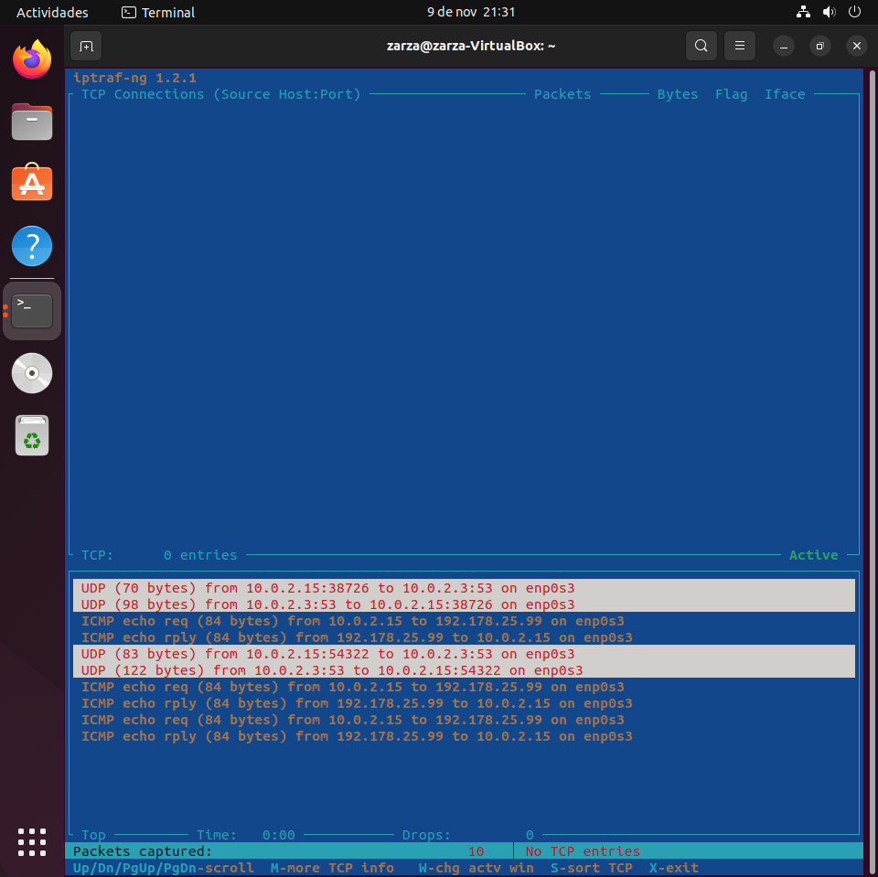

### Interpretación

Permite consultar estadísticas de tráfico, paquetes, conexiones y protocolos.

Es útil para analizar el uso de la red y detectar actividad anormal.

---

## 4.4. bmon

### Finalidad

Permite monitorizar el tráfico de red en tiempo real mediante una interfaz interactiva.

### Sintaxis

```bash
bmon [opciones]
```

### Opciones importantes

| Opción | Descripción |
|---|---|
| `-p` | Selecciona una interfaz de red. |
| `-o` | Permite seleccionar el formato de salida. |

### Ejecución

```bash
bmon -p enp0s3
```

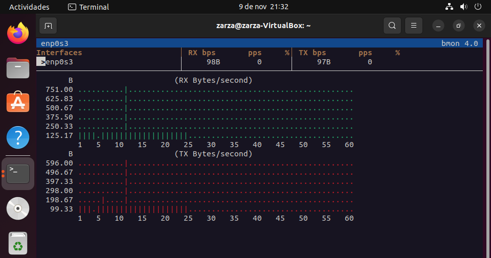

### Interpretación

Muestra las tasas de recepción y transmisión de datos, normalmente expresadas en bits o bytes por segundo.

Es útil para comprobar cuánto tráfico genera o recibe un servidor.

---

# 5. Monitorización de puertos y conexiones

## 5.1. ss

### Finalidad

El comando `ss` permite consultar las conexiones de red y los puertos que están abiertos o escuchando en el sistema.

### Sintaxis

```bash
ss [opciones]
```

### Opciones importantes

| Opción | Descripción |
|---|---|
| `-t` | Muestra conexiones TCP. |
| `-u` | Muestra conexiones UDP. |
| `-l` | Muestra los puertos en escucha. |
| `-n` | Muestra direcciones y puertos numéricos. |
| `-p` | Muestra los procesos asociados a las conexiones. |

### Ejecución

```bash
sudo ss -tulnp
```

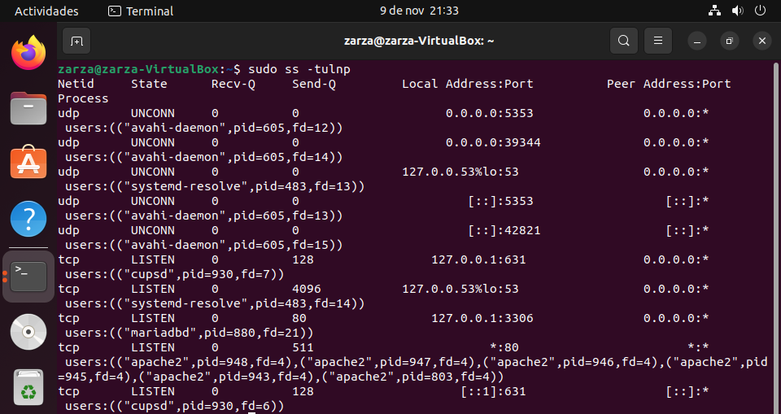

### Interpretación

Muestra los puertos abiertos, el protocolo utilizado, las direcciones locales y los procesos asociados.

Es útil para comprobar qué servicios están escuchando en el servidor.

---

## 5.2. nmap

### Finalidad

Nmap es una herramienta que permite analizar puertos y descubrir qué servicios están disponibles en un equipo.

### Sintaxis

```bash
nmap [opciones] [objetivo]
```

### Opciones importantes

| Opción | Descripción |
|---|---|
| `-p` | Especifica los puertos que se quieren analizar. |
| `-sT` | Realiza un escaneo mediante conexiones TCP. |
| `-sV` | Intenta identificar las versiones de los servicios. |

### Ejecución

```bash
nmap -sT -p 80 localhost
```

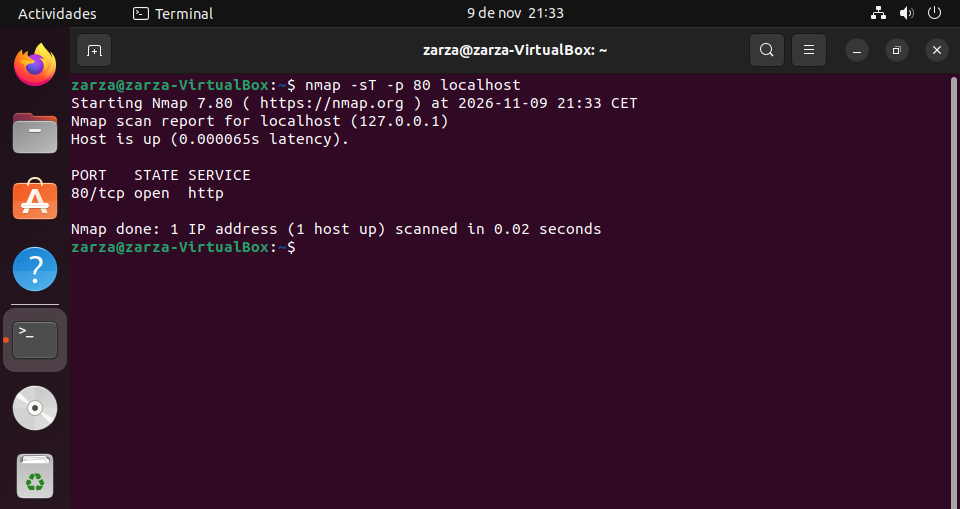

### Interpretación

Muestra el estado del puerto analizado. Puede aparecer como:

- **open:** el puerto está abierto y hay un servicio aceptando conexiones.
- **closed:** el puerto es accesible, pero no hay ningún servicio escuchando.
- **filtered:** no se puede determinar su estado debido a filtros de red o cortafuegos.

Permite comprobar la disponibilidad de servicios en un equipo.

---

# 6. Análisis de resultados

## 6.1. ¿Cómo comprobarías la cantidad de memoria RAM disponible?

Utilizaría el comando:

```bash
free -h
```

Este comando muestra la memoria total, utilizada y disponible.

La columna `available` permite conocer cuánta memoria puede utilizar el sistema sin recurrir excesivamente a la memoria swap.

## 6.2. ¿Qué diferencia existe entre df y du?

La diferencia principal es:

- **df:** muestra el espacio utilizado y disponible de los sistemas de archivos o particiones.
- **du:** muestra cuánto espacio ocupan archivos y directorios concretos.

Por ejemplo:

```bash
df -h
```

Permite comprobar el espacio libre del disco, mientras que:

```bash
du -sh /var/log
```

Permite conocer el tamaño total de la carpeta de registros.

## 6.3. ¿Qué diferencias existen entre ss y nmap?

- **ss:** muestra las conexiones de red y los puertos en escucha del propio sistema. También permite consultar los procesos asociados.
- **nmap:** analiza los puertos de un equipo objetivo para comprobar cuáles están abiertos, cerrados o filtrados.

Por tanto, `ss` permite consultar el estado de las conexiones locales, mientras que `nmap` permite analizar la disponibilidad de servicios desde una perspectiva de red.

## 6.4. ¿Cómo comprobarías si un servidor tiene abierto el puerto 80?

Utilizaría el siguiente comando:

```bash
sudo ss -lntp | grep ':80'
```

También podría comprobarlo mediante:

```bash
nmap -p 80 localhost
```

Si el resultado indica `open`, significa que el puerto está abierto y acepta conexiones.

Si aparece `closed`, no hay ningún servicio escuchando en ese puerto.

## 6.5. ¿Qué herramienta utilizarías para detectar un posible cuello de botella en el disco?

Utilizaría `iostat`, especialmente con la opción `-x`:

```bash
iostat -xz 1 3
```

Esta herramienta permite analizar la actividad de lectura y escritura, los tiempos de espera y el porcentaje de utilización del dispositivo.

Un porcentaje de utilización elevado y tiempos de espera importantes pueden indicar problemas de rendimiento.

## 6.6. ¿Por qué es importante monitorizar los recursos de un servidor?

La monitorización es importante porque permite conocer el estado y rendimiento del servidor en todo momento.

Gracias a estas herramientas se pueden detectar:

- Consumo excesivo de CPU.
- Falta de memoria RAM.
- Discos casi llenos.
- Tráfico de red anormal.
- Servicios que no funcionan correctamente.

Además, permite anticiparse a posibles fallos, mejorar el rendimiento, planificar ampliaciones de recursos y garantizar la disponibilidad de los servicios.

---

# 7. Conclusión

Durante esta práctica se han conocido y utilizado diferentes herramientas de monitorización de Linux.

Se ha aprendido a consultar los procesos activos, analizar el consumo de CPU y memoria, comprobar el almacenamiento disponible, observar el tráfico de red y revisar los puertos y conexiones del servidor.

También se ha trabajado con Markdown para documentar los comandos y con GitHub para organizar y publicar los resultados.

Estas herramientas son fundamentales para la administración de sistemas Linux, ya que permiten detectar problemas, mejorar el rendimiento y mantener los servidores funcionando correctamente.

---
